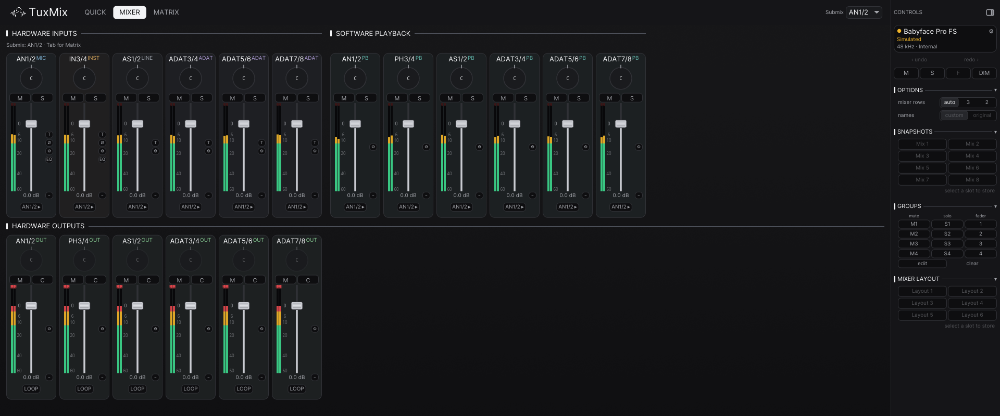

<div align="center">


# TuxMix

**The TotalMix experience for RME interfaces, native on Linux.**

[](https://aur.archlinux.org/packages/tuxmix)   [](docs/guide.md#license)

<br>



</div>

<br>

Routing, gains, monitoring, EQ, FX sends and scenes for RME interfaces,
without the Windows software. Reverse-engineered from the vendor protocol and
validated on real hardware.

> **Supported today:** the Babyface Pro FS. More RME models are the goal,
> see [Contributing](CONTRIBUTING.md) to help bring yours.

- **Three views**: Quick, Mixer and Matrix
- **The whole DSP mixer**: preamp, trim, EQ, width, loopback, mute/solo groups
- **Reverb and echo**, computed on the computer as TotalMix FX does (kernel driver 0.2.5)
- **Snapshots and layouts**, undo/redo, custom channel names
- **Lives in the tray**: the front-panel DIM button and your mix survive a replug
- **GUI and TUI**, over the [kernel driver](https://github.com/ismail-bahloul/babyface-pro-linux) or plain libusb

## Install

```sh
paru -S tuxmix-bin    # Arch, CachyOS: prebuilt
paru -S tuxmix        # Arch, CachyOS: built from source
```

Debian, Ubuntu, Fedora: the `.deb` and `.rpm` attached to each
[release](https://github.com/ismail-bahloul/TuxMix/releases). Elsewhere:
`cargo build --release`, see the [guide](docs/guide.md#building-from-source).
Try it without hardware: `tuxmix --mock`.

## Learn more

<div align="center">

[Guide](docs/guide.md) · [Changelog](CHANGELOG.md) · [Contributing](CONTRIBUTING.md) · [Kernel driver](https://github.com/ismail-bahloul/babyface-pro-linux)

Related: [Audra](https://github.com/Vyeche/Audra), a community mixer for the Babyface Pro FS built on tuxmix-core (early preview, not maintained here)

</div>

## Other RME units on Linux

Until TuxMix drives them, these projects do:

- [TotalControl](https://github.com/jspx-projects/TotalControl), a fork of
  TuxMix by jspx-projects, with its own driver: Fireface UC and UCX,
  Babyface (classic) experimental.
- [fireface-ucx-linux](https://github.com/realbogart/fireface-ucx-linux): a
  kernel driver and a terminal mixer for the Fireface UCX.
- [oscmix](https://github.com/michaelforney/oscmix): the mixer of the
  Fireface UCX II, 802 and UFX family in class-compliant mode.

## License

`tuxmix-core`, the docs and most of the tools are MIT; the applications,
the USB backend and the ALSA plugin are GPL-3.0, see
[the license section](docs/guide.md#license). Forks are welcome under either.
They run under their own name: see [`TRADEMARK.md`](TRADEMARK.md).
