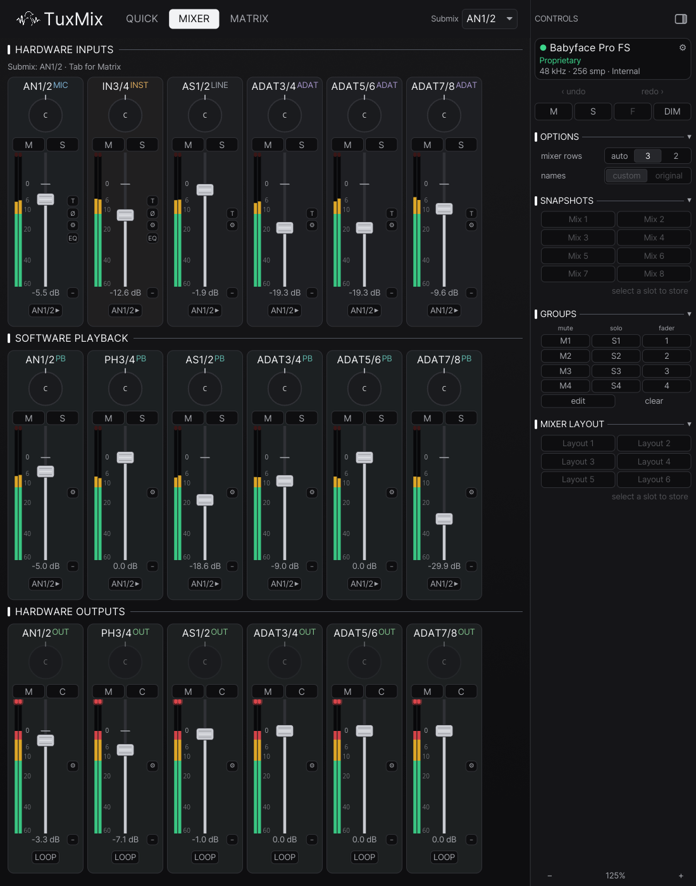

<div align="center">


# TuxMix

**The TotalMix experience for RME interfaces, native on Linux.**

[](https://aur.archlinux.org/packages/tuxmix)   [](docs/guide.md#license)

<br>



</div>

<br>

Routing, gains, monitoring, EQ, FX sends and scenes for RME interfaces,
without the Windows software. Reverse-engineered from the vendor protocol and
validated on real hardware.

> **Supported today:** the Babyface Pro FS. More RME models are the goal,
> see [Contributing](CONTRIBUTING.md) to help bring yours.

- **Three views**: Quick, Mixer and Matrix
- **The whole DSP mixer**: preamp, trim, EQ, width, loopback, mute/solo groups
- **Snapshots and layouts**, undo/redo, custom channel names
- **Lives in the tray**: the front-panel DIM button and your mix survive a replug
- **GUI and TUI**, over the [kernel driver](https://github.com/ismail-bahloul/babyface-pro-linux) or plain libusb

## Install

```sh
paru -S tuxmix        # Arch, CachyOS
```

Other distributions: `cargo build --release`, see the
[guide](docs/guide.md#building-from-source).
Try it without hardware: `tuxmix --mock`.

## Learn more

<div align="center">

[Guide](docs/guide.md) · [Changelog](CHANGELOG.md) · [Contributing](CONTRIBUTING.md) · [Kernel driver](https://github.com/ismail-bahloul/babyface-pro-linux)

</div>
