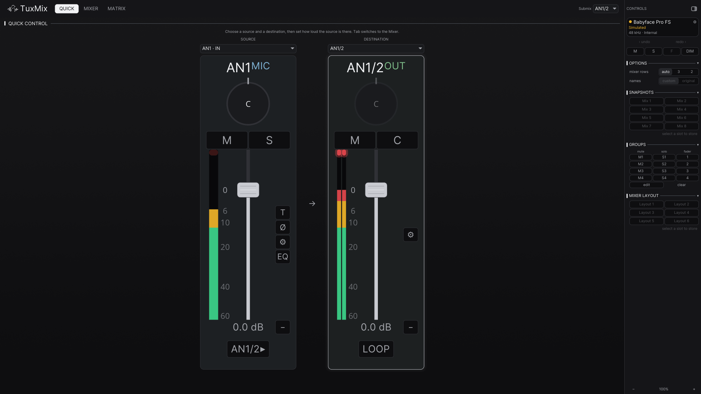
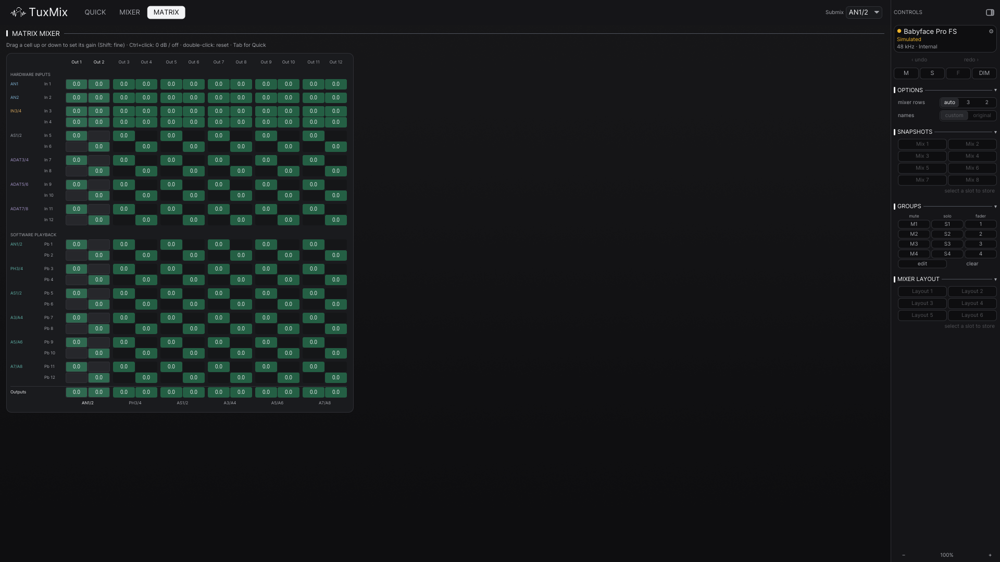

# TuxMix guide

The details behind the [README](../README.md): views, background mode, how
TuxMix fits into the Linux audio stack, the workspace layout and the
project status.

- [Views](#views)
- [Running in the background](#running-in-the-background)
- [The Linux audio stack](#the-linux-audio-stack)
- [Workspace](#workspace)
- [Status](#status)
- [Building from source](#building-from-source)
- [License](#license)

## Views

| Quick | Matrix |
|:---:|:---:|
|  |  |

- **Quick**: one source into one destination, the fastest way to a mix.
- **Mixer**: every strip, TotalMix-style, on three rows (hardware inputs,
  software playback, hardware outputs) or two on a wide window.
- **Matrix**: the full routing grid.

`tuxmix --view quick|mixer|matrix` opens a given view; `--mock` runs against
a simulated device, no hardware needed.

## Running in the background

With a system tray (KDE Plasma, or GNOME with the AppIndicator extension),
closing the window keeps TuxMix running, as TotalMix does on Windows: the
front-panel DIM button and the restore of your mix after a replug are
TuxMix's job while it runs. The tray icon toggles the window; its menu has
Dim, Recall mix 1-8, Settings and Quit. `tuxmix --minimized` starts hidden,
and Settings (Ctrl+,) can start TuxMix with your session. Without a tray,
closing the window quits. One TuxMix runs per session: a second launch shows
the first.

## The Linux audio stack

Two ways to get sound from the Babyface Pro FS:

1. **Kernel driver** (sibling repo
   [`babyface-pro-linux`](https://github.com/ismail-bahloul/babyface-pro-linux)):
   the production path. It exposes a real ALSA card (PipeWire sink/source,
   low latency) whose mixer is the ALSA control set, and TuxMix drives it
   through the ALSA backend.
2. **TuxMix's USB backend** (libusb): the reference/development path for
   full control and streaming without the kernel driver.

`tools/alsa/` has the ALSA plugin and PipeWire configuration glue.

## Workspace

- **`tuxmix-usb`**: the low-level USB backend, the full vendor protocol of
  the Babyface Pro FS proprietary mode (crosspoints, masters, gains, preamp,
  EQ, pitch, loopback, width, FX, the front-panel emulation),
  reverse-engineered from Windows captures and validated on hardware. It
  refuses to open the device while the kernel driver
  (`snd-usb-babyface-pro`) owns it.
- **`tuxmix-core`**: the device model and control API (`RmeDevice` trait)
  with three backends: USB (libusb), ALSA (the kernel driver's controls) and
  mock (tests, scenes).
- **`tuxmix-gui`** (iced) and **`tuxmix-tui`** (ratatui): the interfaces.
  Custom canvas faders, VU meters with real ballistics, multi-select, live
  routing matrix. `GUI-NOTES.md` holds the design log.
- **`tuxmix-sys`**: FFI bindings.

## Status

- The protocol layer (`tuxmix-usb` + `tuxmix-core`) is complete and
  hardware-validated: the laws are calibrated, not guessed.
- The GUI and TUI are functionally complete; the road to 1.0 is validation
  on real hardware and desktops (tray on KDE/GNOME), see
  [`CHANGELOG.md`](../CHANGELOG.md).
- The ALSA backend (`tuxmix-core`'s `alsa` feature) is hardware-validated,
  including Input/Playback Mute and Solo, which zero the crosspoints the way
  the USB backend does.
- The ALSA backend follows the card: changes made by the front panel,
  `alsamixer`, `alsactl restore` or any other client show up in the GUI
  within a tick. It also plays TotalMix's part for the DIM button: the
  kernel driver only counts presses (`DIM Button Press Count`) and TuxMix
  toggles `Dim` on each one, so the hardware DIM button works while TuxMix
  runs. `cargo run --example panel-watch` prints what the backend sees.
- See the sibling driver repo for the kernel-side status.

## Building from source

```sh
cargo build --release          # the whole workspace
cargo test                     # protocol laws, panel state machine, GUI state, ...
cargo build -p tuxmix-core --no-default-features --features usb
```

The binaries land in `target/release/`: `tuxmix-gui` (installed as `tuxmix`
by the AUR package) and `tuxmix-tui`.

## License

MIT for the application: `tuxmix-core`, `tuxmix-gui`, `tuxmix-tui` and the
rest of the tree, see [`LICENSE`](../LICENSE).

Two crates are copyleft: `tuxmix-usb` is GPL-3.0-or-later and `tuxmix-sys` is
GPL-3.0. The built binaries link both, so as a whole they are GPL-3.0, which
is the license the AUR package declares.
